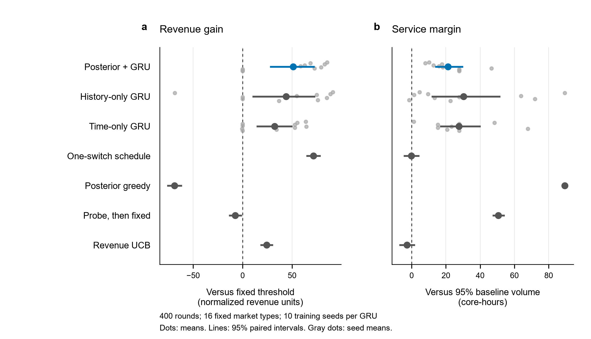

# Steer：云资源市场的容量计费、动态门槛与联盟响应

**Dynamic allocation thresholds under strategic resource reporting and collusion.**

本项目研究一个具体问题：云计算平台能否根据买方的公开申报和成交历史动态调整资源分配门槛，在买方故意低报需求、共享资源并互相补偿时，获得比固定门槛更高的收入？

这是一个可运行的、两名买方与两台虚拟机的研究原型。第一版发现动态门槛会被理性联盟反向利用；第二版改为按实际获配虚拟机容量收费，在给定四种市场中堵住低报降低账单的空间，但**尚未通过动态门槛训练得到额外收益，也没有让所有买方诚实申报**。本仓库保留每轮迭代的正向结果和失败测试。

## 第二版：先堵住低报节省账单的空间

新规则是 `账单 = 0.78 × 实际获配VM容量`，单价在全部400轮内承诺不变，不发补贴。例如，获得3核VM就支付2.34，申报1核也不能降低这台VM的账单。联盟仍可以共享资源、重新安排作业和内部转账。

下表来自第二版独立测试流；“旧机制”是原收费方式下的固定 `rho=0.5`，“新机制”是验证集选定的按容量收费、固定 `rho=0`。每项均为400轮累计值。学习型测试包含16类隐藏模型、每类100个配对world；强联盟按4种实际市场、每种100个world统计。

| 场景 | 平台收入：旧 → 新 | 完成任务数：旧 → 新 | 判断 |
|---|---:|---:|---|
| 精确理性联盟 | 1360 → **1560（+14.71%）** | 800 → **800** | 四市场内保护收入，任务量不降 |
| 默认学习型买方总体 | 1369.89 → **1377.93（+0.59%）** | 678.16 → **680.99** | 总体收入、任务数、完成价值联合通过 |
| 学习型联盟 | 1367.46 → **1387.18（+1.44%）** | 686.80 → **693.07** | 联盟子组得到改善 |
| 独立学习买方 | 1372.33 → 1368.69（−0.27%） | 669.51 → 668.90 | 未通过；不能声称所有买方场景受益 |

总体收入增幅的双侧95%配对区间为 **[0.18%, 1.00%]**，任务增量区间为 **[1.31, 4.31]**；联盟子组收入增幅区间为 **[0.84%, 2.06%]**。这些是固定四市场目录内的模拟不确定性，不覆盖现实需求变化。A、D市场的学习型收入和服务点估计仍下降。

第二版也完成10个种子、每种子1,996,800市场时隙的动态门槛训练。动态动作限定在 `rho∈{0.5,1}`，对照仍保留全部四种固定门槛。**10个种子全部回退到同机制固定 `rho=0`；动态相对新固定的增量为零。** 上述提升应归于收费与固定规则的改变，不能归于训练出的引导能力。

抗操纵证据分两层：89种前瞻攻击模板在独立验证/测试中未找到增加联盟效用的偏离；另有精确枚举与逐轮效用上界证明，在本四市场、整台VM共享、固定单价 `0<p<0.8` 的假设下，理性联盟每轮满租最优，无法通过暂时少买来诱导未来规则并额外获利。后者不推广到任意需求或任意资源组合。

**保护收款不等于消除低报，也不等于拆散联盟。** 在新规则的精确最优响应中，统计低报率甚至从50%升到87.5%，但没有减少实际容量账单。`p=0.8` 时低价值市场已经出现退出无差异；更低价值或能够少租VM完成同样任务的新市场也会破坏上述保证。

仅在旧规则上增加 `rho≥0.5` 下限也做了测试：强联盟收入改善，但任务数由800降至782.5，且仍存在有利可图的前瞻操纵。因此该约束不作为解决方案。

- [第二版详细结果、失败分组与边界](docs/v2_results.md)
- [第二版参考数据与来源记录](results/reference/v2/)
- [冻结评估协议](docs/v2_evaluation_protocol.md)、[容量收费附录](docs/v2_capacity_tariff_addendum.md)、[受限门槛引导附录](docs/v2_restricted_steering_addendum.md)

## 进一步迭代：公开历史能否改善资源匹配

在门槛训练没有增益后，另冻结一个探索方案：保持 `p=0.78`、`rho=0`，根据公开报告更新对买方类型的后验，在总分配容量相同的匹配中，优先选择预测任务数较高的匹配，完成价值作为平局条件。它每轮决策，覆盖全部400轮，不使用前述200轮保持期；平台不读取真实类型。

对照在验证集比较 **3种固定匹配方式 × 4种固定门槛**，最终选中固定 `rho=0`、平局时优先将3核VM分给买方0。随后使用独立测试流 `720041`，没有按测试重选对照。

| 默认学习型总体，400轮 | 旧固定规则 | 新机制最佳固定匹配 | 公开历史匹配 |
|---|---:|---:|---:|
| 平台收入 | 1368.80 | **1390.75** | 1388.97 |
| 完成任务数 | 678.10 | **690.83** | 689.16 |
| 完成任务价值 | 3461.95 | 3512.30 | **3539.50** |

公开历史匹配相对最佳固定匹配，收入差为 **−1.78，95% CI [−2.31, −1.22]**，任务差为 **−1.67，95% CI [−1.94, −1.42]**，完成价值增加27.21。因此它没有实现收入与任务量同时改善；仅与旧规则比较会夸大引导贡献。联盟允许自由迁移任务时，同收费的这些匹配方式产生完全相同的联合指标；这次变化主要影响独立买方，不能视为新增抗共谋效果。

这是读过第二版结果后提出、用全新验证/测试流评估的探索性跟进，未替换第二版主检验。完整分市场结果与冻结记录见[详细报告](docs/v2_results.md#7-分配匹配规则迭代)。

## 第一版：动态门槛的历史结果

下面的数值来自归档的独立测试。主实验每种学习策略使用 10 个训练种子，测试包含 16 类市场，每类 100 个新 world；固定门槛在验证集选择，最终为 `rho = 0.5`。

| 条件 | 动态策略相对固定门槛的结果 | 解释 |
|---|---:|---|
| 默认学习型买方，总体 | 收入 **+3.73%**，95% CI **[2.08%, 5.25%]** | 通过预设的总体收入与成交核时条件 |
| 默认模型中的联盟子组 | 收入 **+1.46%** | 增幅小于总体；不表示联盟被拆散 |
| 表格型价值学习器 | 收入约 **−0.16%**，区间跨零 | 没有可靠的动态优势 |
| 每轮精确最优响应的联盟 | 收入 **−5.14%** | 固定门槛更好 |
| 前瞻伪装攻击的一个案例 | 平台收入 **1344 → 964**，联盟效用 **+80** | 联盟通过短期少报、少买，诱导平台提前放宽门槛 |

主动态策略累计收入为 **1418.13**，固定门槛为 **1367.13**；金额采用模型内的归一化单位。主策略保留了无门槛基线 **96.19% 的已租核时**。该条件只约束总体平均核时：联盟组完成作业数仍从 **685.95 降至 671.20**，不能称为服务无损。10 个训练种子中有 3 个最终退化为固定门槛，其余 7 个产生正增益。

“先严格、后放松”的简单预定日程也具有竞争力，其测试收入高于主策略，但已租核时约为无门槛基线的 94.99%，略低于预设下限。目前没有证明复杂历史引导优于充分调优的简单日程，也没有证明它超越按真实市场类型选择固定门槛的特权参照。



图中左侧为相对验证集选定固定门槛的收入差，右侧为相对“无门槛基线核时的 95%”的余量。线段为双侧 95% 配对置信区间，浅色小点为各训练种子的均值。强联盟与前瞻攻击结果见下列归档文件。

- [主检验及置信区间](results/reference/primary_summary.json)
- [全部主实验方法汇总](results/reference/paper_table.csv)
- [四类压力测试](results/reference/stress_summary.csv)
- [前瞻联盟攻击汇总](results/reference/attack_summary.json)
- [预先确定的实验与统计协议](docs/protocol_audit.md)

## 共同模型与第一版收费

这里的“低报”是**低报最小资源需求量**，不是压低报价。平台的单位价格固定；申报量会影响分配资格与账单。

| 项目 | 设置 |
|---|---|
| 资源 | 两台容量分别为 3 核、2 核的完整虚拟机；每轮为 1 小时 |
| 买方申报 | 每人申报 `0/1/2/3`；`0` 为退出，允许高报 |
| 分配资格 | 对容量为 `c` 的虚拟机，要求 `0 < b <= c` 且 `b >= rho * c` |
| 分配目标 | 最大化已分配总容量；多个最优匹配之间均匀随机选择 |
| 账单 | 获配者支付 `0.2 * c + 0.8 * b`；未获配者不支付 |
| 联盟能力 | 共享已租虚拟机、将完整作业重新装箱、自由内部转账；单个作业不能跨虚拟机拆分 |
| 机制动作 | `rho ∈ {0, 1/2, 2/3, 1}`，覆盖此离散模型中的全部不同资格规则 |
| 平台观察 | 时间、申报、分配与账单等公开信息；不读取真实类型、私有效用或买方学习权重 |

原候选中的 `rho = 0.8` 与 `rho = 1` 在此资源设置下产生相同的经济规则。主实验将其合并，并采用相同的学习特征，避免把数字标签的差异误算成机制优势。

四种需求与价值市场如下。每种市场再交叉独立行动／全体联盟、学习率 `0.05/0.20`，形成均匀先验下的 16 类隐藏模型。

| 市场 | 两名买方的需求 | 完成作业的价值 |
|---|---|---|
| A | `(3, 2)` | `(9, 5)` |
| B | `(3, 2)` | `(2.4, 1.6)` |
| C | `(2, 2)` | `(5, 5)` |
| D | `(1, 3)` | `(2, 8)` |

主方法使用有限模型目录的贝叶斯后验、公开历史特征与 GRU PPO。对照包括全部固定门槛、无后验的历史 GRU、仅看时间的 GRU、预定切换日程、简单收入反馈、后验贪心，以及先探索再固定。`fete_fixed` 是一个简化对照，不是原论文中经训练的 FETE 方法复现。

每个 episode 共 400 轮：前 200 轮每 10 轮可调整一次门槛，后 200 轮固定最后的门槛，买方继续行动。**所有 400 轮均计入收入目标。** 本次不发返利，运营成本与切换成本均设为零，报告的是模型中的净收款，不能直接等同于实际商业利润。

精确单轮联盟压力测试按 4 个实际市场统计，合并没有行为差异的学习率标签。前瞻攻击则在预先指定的 89 个模板中，按独立攻击验证集上的联盟全期效用选择，再用新轨迹评估；它展示可获利偏离的存在，并未求解所有可能的跨期联盟策略。

## 安装

推荐使用 **Python 3.11** 和独立虚拟环境。核心参考环境为 NumPy `2.4.4`、PyTorch `2.5.1`；当前实现使用 CPU，不需要 GPU。

```bash
git clone https://github.com/40lin/steer.git
cd steer
python -m venv .venv
```

Windows PowerShell 激活环境：

```powershell
.\.venv\Scripts\Activate.ps1
```

Linux / macOS 激活环境：

```bash
source .venv/bin/activate
```

安装核心依赖：

```bash
python -m pip install --upgrade pip
python -m pip install -r requirements.txt
```

如希望明确使用 PyTorch 的 CPU 发行版，可在安装 `requirements.txt` 前执行：

```bash
python -m pip install torch==2.5.1 --index-url https://download.pytorch.org/whl/cpu
```

需要重新生成图表时，再安装可选绘图依赖：

```bash
python -m pip install -r requirements-plot.txt
```

请不要将旧版 Matplotlib 与 NumPy 2 混装；可选依赖文件给出本项目采用的兼容版本。

## 快速检查

在仓库根目录运行：

```bash
python scripts/run_experiment.py check
python scripts/run_experiment.py smoke
```

`check` 运行经济模型、环境、后验回放、统计和攻击接口的自检。`smoke` 执行小规模端到端检查，确认训练与评估链路能够运行；它不是正式实验，不用于支撑上述收入结论。

## 第二版复现

安装上述核心依赖后，运行快速核验：

```bash
python code/capacity_billing_env.py
python code/analyze_capacity_billing.py --self-test
python code/capacity_billing_attacks.py self-test
python code/v2_mechanism_audit.py
```

完整运行按容量收费的验证、10种子训练、测试前冻结、独立测试、统计、前瞻攻击和探索性价格网格：

```bash
python scripts/run_v2_capacity.py all --workers 4
```

也可依次运行 `train`、`test`、`sensitivity` 三个阶段。训练合计19,968,000个市场时隙，评估另计；输出在 `experiments/v2_capacity_billing/`，独立精确枚举在 `experiments/v2_audit/`。第一版无需先训练，第二版主流程可独立运行。测试冻结后不会覆盖结果；重复研究请用新的仓库副本。

公开历史匹配的独立探索实验无需训练checkpoint：

```bash
python code/capacity_allocation_steering.py all
```

它依次执行自检、协议冻结、12种固定对照的验证选择、新测试及10,000次配对分层bootstrap。全部候选使用相同收费；联盟能力与任务账本不变。

复核“只改门槛约束”的失败分支，需要先完成第一版训练，或通过 `--checkpoint-dir` 指定已有的10个 `belief_*.pt`：

```bash
python code/v2_threshold_constraints.py run --workers 3
python code/v2_threshold_constraints.py summarize
python code/v2_threshold_constraints.py attacks
```

参考归档保留历史运行的原始哈希；发布时增加了门槛约束脚本的checkpoint路径参数和第二版编排入口，科学逻辑未改。参考摘要本身不包含重算所有置信区间所需的完整轨迹。

## 第一版完整复现

```bash
python scripts/run_experiment.py full
```

该命令依次完成验证集基线与日程选择、三类 GRU 策略各 10 个种子的训练、测试前冻结、独立测试与统计、四类压力测试，以及种子 `0/4/9` 的前瞻联盟攻击。若需调整训练阶段的并行数：

```bash
python scripts/run_experiment.py full --workers 2
```

`--workers` 控制训练进程数；评估和压力测试使用各自的并行设置。完整训练合计 **59,904,000 个实际市场时隙**，验证与测试另计，因此耗时显著高于 smoke，具体取决于 CPU、内存及进程数。保持期也计入训练交互数量。

运行输出保存在被 Git 忽略的 `experiments/` 中，包括原始 NPZ、模型权重、日志、冻结清单和新生成的统计结果。`results/reference/` 是已经完成的研究运行快照，不会由每次测试自动改写。完整复现采用冻结文件保护已选参数与测试来源；再次进行完整研究时，使用新的仓库副本，保留旧实验记录。

安装绘图依赖并完成主实验后，可生成新结果的 PDF、SVG 和 PNG：

```bash
python code/make_threshold_figures.py
```

验证与测试随机流分开；主测试在所有策略和训练种子间复用相同的外生 world。统计使用 **10,000 次交叉配对 bootstrap**：重抽训练种子，并在每个固定市场类型内重抽 world，保持不同方法之间的配对；不把 400 个时隙当作独立样本，也不把重复使用的固定基线算成 10 份独立数据。

参考结果受买方行为假设、训练预算、软件版本和浮点计算影响。相同配置用于复核趋势与数值范围，不承诺不同硬件和依赖环境下逐位一致。

## 仓库结构

| 路径 | 内容 |
|---|---|
| `code/` | 市场环境、平台训练、基线、统计、强联盟压力测试及绘图代码 |
| `scripts/` | 检查、smoke 和完整复现入口 |
| `docs/` | 实验协议与实现说明 |
| `config/` | 独立精确诊断的参数；主学习实验参数定义在 `code/` 中 |
| `results/` | 已完成运行的轻量参考结果与图表 |
| `requirements.txt` | 核心依赖 |
| `requirements-plot.txt` | 可选绘图依赖 |
| `experiments/` | 本地运行输出，运行时生成，不纳入版本控制 |

仓库不包含原论文 PDF、本机虚拟环境、历史模型权重或完整原始轨迹。需要原始轨迹与 checkpoint 时，请运行完整流程生成。

`code/exact_threshold_stress.py` 是另一个单轮理性响应诊断，读取 `config/exact_diagnostic.json`。其中的“一轮探测后换门槛”允许第 2 轮立即调整，不应与主实验每 10 轮调整的结果直接混比；相同 10 轮节奏的解析诊断另见 [exact_block10_diagnostic.json](results/reference/exact_block10_diagnostic.json)。`docs/` 保留历史实验协议；发布版增加了跨平台运行和冻结保护，差异及原始源码哈希见 [reference_metadata.json](results/reference/reference_metadata.json)。

## 结论边界

第一版支持特定学习响应下的动态增收；第二版支持给定四市场内按实际容量收费的收入保护。动态门槛没有超越新固定规则，后续公开历史匹配也未超过调优固定匹配的收入和任务数。上述结果均没有证明诚实申报、联盟解体、任意联盟下的收入保障、逐买方服务保障或真实云平台上的有效性。

第一版的精确联盟失败与前瞻操纵、第二版的全部训练种子回退和局部市场损失，均保留在归档中。报告中的收入是扣除零返利后的模拟净收款；未建模真实运维成本，因此不能直接称为商业利润。
